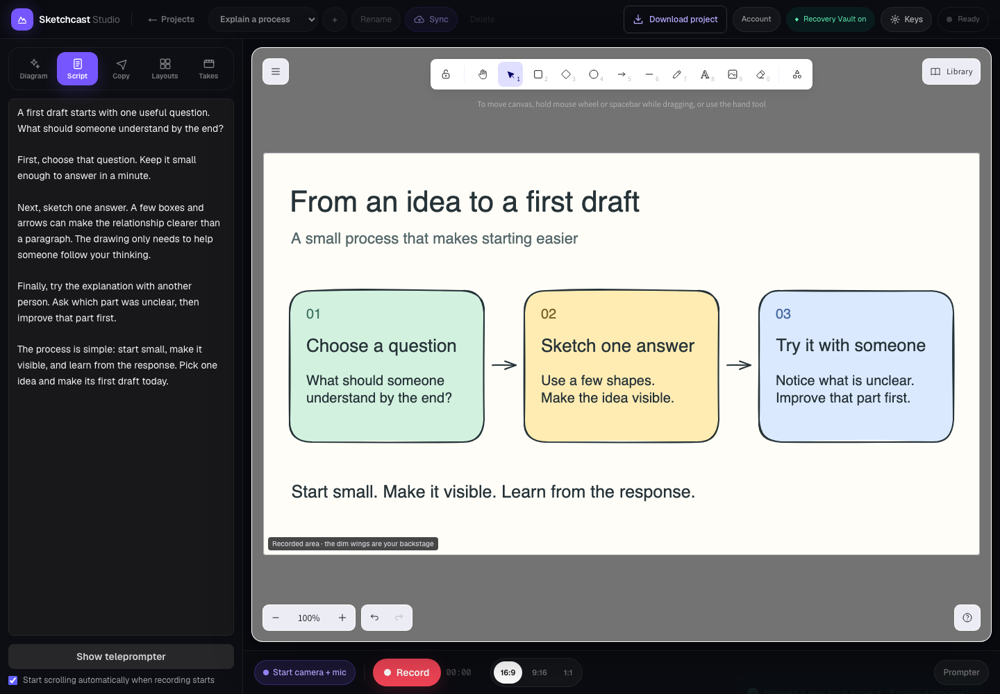

# Sketchcast Studio

Turn a whiteboard explanation into a video, with an optional webcam and a private teleprompter.

[](https://github.com/chelsea-hq/sketchcast/actions/workflows/ci.yml)
[](https://github.com/chelsea-hq/sketchcast/actions/workflows/codeql.yml)
[](LICENSE)

Free, local-first, and self-hostable. No account, credit card, or AI key is needed to sketch, record, edit, and download a take. **Pre-1.0:** download videos you care about; browser storage is not a backup.

## Quickstart

Install **Node.js 22.22.2 or newer within 22.x** (with npm) and Git. Use desktop Chromium for the recording walkthrough; mobile is for project preparation.

```bash
git clone https://github.com/chelsea-hq/sketchcast.git
cd sketchcast
npm ci
npm run dev
```

Wait for Next.js to print **Ready**, then open [localhost:3000/studio](http://localhost:3000/studio). You should see **Make your next idea clear.**, three teaching starters, and your local projects. No environment file is required. With nvm installed, `nvm use` selects the repo's Node version.



[Features](#features) · [First recording](#make-your-first-recording) · [Project files](docs/PROJECT-FILES.md) · [Configuration](#configuration-and-privacy) · [Self-hosting](#self-hosting) · [Contributing](#contributing) · [Roadmap](ROADMAP.md)

## Features

- **Editable whiteboard:** draw with Excalidraw, paste images, or turn a topic into a diagram and talk track. No-key generation uses templates; provider AI is optional.
- **Three free teaching starters:** explain a process, compare two ideas, or teach a concept with an original editable board and sample script. Each opens as a separate local project.
- **Board + webcam recording:** capture landscape (1920×1080), portrait (1080×1920), or square (1080×1080). Camera and microphone are optional.
- **Private teleprompter:** scroll your script over the stage without including it in the video.
- **Local projects and files:** autosave, actual board previews, search, sorting, and duplication. Download or import a `.sketchcast` project file to move boards, scripts, and layouts between browsers. Recordings stay in the local Recovery Vault and need separate downloads.
- **Edit and export:** review takes, make manual cuts, and export in the selected format. Optional Deepgram transcription enables word-based cuts.
- **Reusable layouts and post copy:** save board/script layouts and draft hooks, titles, descriptions, and hashtags.
- **Optional encrypted project sync:** explicitly configured hosts can sync encrypted boards, scripts, and layouts between devices. Video takes are excluded.

## Make your first recording

For a prepared example, select **Explain a process** under **Skip the blank canvas**, then continue at step 4. The three starters use original boards and scripts included under this repository's MIT license; they need no account, key, or paid service.

1. Choose **Build a diagram**, name your project, and select **Create and prepare**.
2. Enter `Plant a seed -> Add water -> Give it light -> Watch it grow`, then **Generate diagram**. Without a provider key, the result is labeled **Template mode**.
3. Select **Add to board** and optionally **Use script**. Position the diagram inside the recorded area.
4. Select **Record** to check the frame and output format. Connect camera + mic if wanted, or leave them off for a silent board-only take.
5. Select **Start recording**, wait for the countdown, and explain your idea. Select **Stop & save** when finished.
6. Review the take, wait for its local-save confirmation, then download it or open the editor. Edited export runs locally in real time; keep the tab visible.

Clearing site data, changing browser profiles or site origins, and storage eviction can make local work unavailable. Use **Download project** to keep an unencrypted copy of your board, supported images, script, and layout, up to 10 MiB. Download final videos separately. See [project files](docs/PROJECT-FILES.md) for import steps and format limits, and the [release checklist](docs/RELEASE-CHECKLIST.md) for browser verification steps.

## Configuration and privacy

The default Community installation needs no hosted accounts or credentials.

| Action | Where data goes |
| --- | --- |
| Sketch, record, manually edit, download | This browser; drafts and takes use local storage/IndexedDB |
| Import, duplicate, or download a project file | This browser; no project content is uploaded. Files are unencrypted and exclude recordings, keys, recovery codes, and account state |
| Generate diagrams or copy without a key | The Sketchcast server receives the topic/notes and returns a template; no AI provider is called |
| Generate with your provider key | The browser sends the key and prompt to the Sketchcast server, which calls your selected provider without persisting the key |
| Load a transcript | Audio is sent through the Sketchcast server to Deepgram when you request transcription |
| Run encrypted sync | Encrypted project metadata goes to the host's private Blob store; the recovery code and video takes are excluded |

Open **Keys** in the studio to select Anthropic, OpenAI, OpenRouter, or Gemini and optionally set a model identifier. Optional Deepgram keys go in the same settings. Keys use session storage by default; remembering them on the device is an explicit opt-in.

Provider usage is billed by your provider. Browser storage can be read by a compromised device, extension, or injected script. Use a host you trust and separate provider keys with appropriate limits. Read [SECURITY.md](SECURITY.md) and the [security model](docs/SECURITY-MODEL.md).

**Local-first does not mean fully offline.** The app and template generation need the Next.js server. Installation/build requires network access, including Google font downloads. Board fonts are served locally with a narrowly allowed Excalidraw CDN fallback.

All optional variables and defaults are in [.env.example](.env.example). Setting `SKETCHCAST_ALLOW_SERVER_KEYS=true` alone does **not** enable host-funded keys: an authenticated active Creator subscription and durable quota are also required, even locally. Community users should enter keys in the studio.

## Self-hosting

Run a production build with Node 22:

```bash
npm ci
npm run build
npm run start
```

Open [localhost:3000/studio](http://localhost:3000/studio). Remote hosting needs HTTPS for device access and a Next.js-compatible server; this is not a static HTML export.

Keep `SKETCHCAST_ALLOW_SERVER_KEYS=false` and `SKETCHCAST_ENABLE_CLOUD_SYNC=false` for the default public BYOK experience. In-app rate limits are process-local; public hosts need their own durable platform limits. Firewall rules from another deployment do not transfer with a clone.

To offer encrypted sync, explicitly enable it, configure a private Vercel Blob store, and add durable rate limits and storage budgets. Consult the [safe hosting profiles](docs/SECURITY-MODEL.md#safe-hosting-profiles).

**Creator Cloud is optional.** The repository includes Clerk, Stripe, and Upstash integrations for a hosted service. Their presence does not mean checkout or funded features are enabled on a deployment. Follow [Creator Cloud setup](docs/CREATOR-CLOUD-SETUP.md) and verify the complete account/billing/quota flow before offering it. Community works without those services.

## Contributing

Read [CONTRIBUTING.md](CONTRIBUTING.md), the [Code of Conduct](CODE_OF_CONDUCT.md), and the [roadmap](ROADMAP.md).

```bash
npm run check
npm run audit:all
```

`check` runs ESLint, standalone TypeScript checks, Vitest, and a production build. `audit:all` blocks high/critical advisories in runtime and contributor dependencies; `audit:release` checks runtime dependencies only. CI runs these checks and the production-mode Chromium suite; CodeQL and Dependabot are configured separately. Run the separate Chromium suite with `npm run test:e2e` after the [browser-test setup](CONTRIBUTING.md#run-browser-checks). A successful build does not certify camera, recording, or export behavior in every browser.

**Dependency status, October 16, 2026:** the full and production audit gates pass, each reporting 0 critical, high, or moderate findings and 4 low affected package records in the KaTeX dependency family. Sketchcast temporarily replaces inherited `braces` with exact-pinned `@dieub/braces-depth-guard@3.0.3-pn.3`. Read the [replacement guide](docs/DEPENDENCY-REPLACEMENTS.md) for its reviewed source, depth protections, remaining limits, and retirement conditions. No advisory is suppressed; passing these gates does not mean the dependency tree has no vulnerabilities.

For branded forks, use the [customization guide](docs/CUSTOMIZATION.md) and optional [Sketchcast Customizer skill](skills/sketchcast-customizer/SKILL.md). Report vulnerabilities privately through [SECURITY.md](SECURITY.md).

## License

Licensed under the [MIT License](LICENSE). Built with [Excalidraw](https://github.com/excalidraw/excalidraw), [Next.js](https://github.com/vercel/next.js), and [React](https://github.com/facebook/react); dependencies retain their own licenses.
